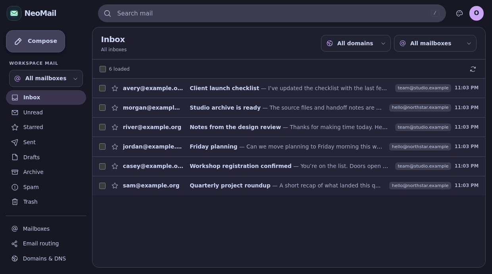

# NeoMail

**Self-hosted email for your domains.** One inbox for multiple addresses, with aliases, forwarding, and disposable inboxes. Install NeoMail on your phone for quick access and opt-in notifications. Connect external agents with revocable, mailbox-scoped MCP tokens—no built-in AI or hosted identity provider required.

[Cloudflare deployment](#deploy-to-cloudflare) · [Standalone hosting](#optional-standalone-hosting) · [Themes](#appearance) · [MCP](#external-agents-via-mcp)



## Deploy to Cloudflare

The Worker serves the app and MCP endpoint, receives mail through **Cloudflare Email Routing**, sends through **Cloudflare Email Sending**, and stores mail in SQLite-backed **Durable Objects** and attachments in **R2**. No SMTP server, VM, or separate database is needed.

1. Install **Bun** and **Node.js 24.4+** (used by the build and test tools). Log in to Wrangler and create the R2 bucket if it doesn't already exist:

   ```sh
   bun install --frozen-lockfile
   bunx wrangler login
   cp wrangler.example.jsonc wrangler.local.jsonc
   bunx wrangler r2 bucket create neomail-mail
   bun run build:cloudflare
   bunx wrangler deploy --config wrangler.local.jsonc
   ```

   Use `wrangler.local.jsonc` for a new instance. Its Worker name and R2 bucket can be changed; keep `CLOUDFLARE_WORKER_NAME` in sync with the Worker name. By default it uses the generated `workers.dev` URL. To use your own hostname, add a custom domain route and optionally set `APP_URL` to your exact HTTPS origin. No Cloudflare Access policy is needed. The tracked `wrangler.jsonc` uses the same generic defaults as the example. Keep your instance-specific settings in the ignored `wrangler.local.jsonc` and store credentials as Worker secrets.

2. Set `CLOUDFLARE_TOKEN` as the **single Cloudflare API credential** for this Worker. For a fresh workspace, also set a temporary `SETUP_CODE` to protect owner creation. Store both as **Worker secrets**, not plain `vars`:

   ```sh
   bunx wrangler secret put SETUP_CODE --config wrangler.local.jsonc
   bunx wrangler secret put CLOUDFLARE_TOKEN --config wrangler.local.jsonc
   ```

   Use a randomly generated setup code of at least 20 characters. An uninitialized Worker will take you to `/setup` but won't create an owner without the correct secret. After you create the owner, `/setup` closes and sign-in happens at `/login`. You can delete `SETUP_CODE` once the account is created.

   For full in-app Cloudflare setup, scope the API token to **your account and the zones you intend to manage**. Give it these permissions (Cloudflare may label Write as Edit):

   | Scope | Permission | Used for |
   | --- | --- | --- |
   | Zone | Zone Read, DNS Read | Find active zones and detect existing MX records |
   | Zone | Zone Settings Write, Email Routing Rules Write | Enable inbound mail and point the catch-all to this Worker |
   | Account | Email Sending Write | Enable outbound sending for a domain |
   | Account | Email Routing Addresses Write | Request and check forwarding destination verification |
   | Zone | DNS Write (optional) | Publish additional records from **Advanced DNS settings** |

   If the token can see more than one account, set `CLOUDFLARE_ACCOUNT_ID` in Worker vars to the account that owns the deployed Worker and zones. Use an account-restricted token even when that variable is set. Select **All zones from an account** if you want to add any current or future domain in that account without changing the token. The Worker does not need access to other Cloudflare products. MCP credentials are separate app-issued tokens for agents, not Cloudflare API tokens.

3. Open the URL printed by Wrangler. Use `/setup` to create your owner account. Then do the day-to-day setup **in the app**:

   - **Domains & DNS → Add domain**: enter a domain already active on Cloudflare DNS in that account. Click **Connect incoming mail** and, if needed, **Enable sending**. Repeat for each domain. Domains do not need to be listed in Worker configuration, and adding them does not require a redeploy.
   - **Mailboxes → Add mailbox** (or **Add a mailbox** in the mailbox picker): choose a domain, an address prefix, and an optional display name. The picker searches mailbox names, addresses, and domains. Add as many addresses as your deployment can support. There is no Cloudflare rule or deployment step per address. The catch-all sends unmatched recipients to the Worker; the app only accepts actual mailboxes and configured aliases or catch-alls.
   - Enable **Disposable inbox** when creating an address for one-time codes or low-priority messages. Open it directly from the mailbox picker or directory. Its messages are excluded from unified mail, search, unread badges, and MCP. Mail is retained until you delete it; reconnecting the address keeps it disposable.
   - **Email routing & webhooks**: create an exact alias or a domain catch-all that forwards to one or more external addresses, delivers to an existing inbox, keeps a local copy while forwarding, or rejects mail. Choose **Existing inbox** when adding a routing rule to forward new mail from a mailbox and keep a copy in its Inbox. This edits the same forwarding configuration as **Mailbox settings**. Use **Verify forwarding destinations** in Email routing, then click the confirmation link at each destination before enabling forwarding. Verified destinations are account-wide. Under **Outbound webhooks**, attach signed HTTPS `mail.received` webhooks to any inbox or exact alias (supports Zapier, Make, Pipedream, n8n, or HTTPS origins listed in `WEBHOOK_ALLOWED_ORIGINS`). Webhooks send arrival metadata only and sign requests with `X-NeoMail-Signature` (`sha256=` HMAC-SHA256 of `<X-NeoMail-Timestamp>.<body>`).
   - **MCP connections**: create a separate, revocable token for each agent. Choose **Read**, **Read and act**, or **Workspace admin**. Disposable inboxes are not available to MCP clients.

### Cloudflare prerequisites and limits

- New domains must already be active Cloudflare DNS zones and included in the API token's scope. Registering domains, changing nameservers at a registrar, and accepting Cloudflare account terms or plan changes are outside the app. A conflicting MX or existing active catch-all is never replaced automatically. Existing exact Cloudflare rules may take priority over the Worker; the app lists them so you can decide whether to keep or change them.
- Cloudflare Email Sending applies its own entitlement, sender-domain, recipient, and rate limits. On Workers Free, outbound mail is limited to verified destinations; general external recipients require Workers Paid. Use Email Sending within [Cloudflare's supported use cases and limits](https://developers.cloudflare.com/email-service/). DNS readiness alone does not prove delivery. Verify incoming, outgoing, and forwarding with real test messages before switching production traffic.
- Removing a domain from the app does not alter its Cloudflare settings or delete stored messages. If you intend to stop using the Worker for a domain, change its routing in Cloudflare before removing it from the workspace.
- Unified search queries the selected mailboxes. For a workspace with many inboxes, use mailbox/domain filters and account for Cloudflare request and SQLite limits. Inbound MIME attachments are separate R2 objects; exceptionally large message bodies are shown as truncated previews.

## Install on iPhone or iPad

Open the workspace in Safari and choose **Share → Add to Home Screen**. Leave **Open as Web App** turned on if shown. The phone layout puts search at the top, folders in the navigation drawer, mailbox switching behind the avatar, and Compose in the inbox header. Pull down from the top of a message list to refresh, swipe left on a message to move it to Trash, or swipe right to mark it read/unread (or recover it from Trash). Back from a message restores the inbox you were reading. Mail needs a connection: only public app assets and the offline screen are cached, not messages or authenticated pages.

## Appearance

Open **Appearance** in the toolbar or go to **Account settings → Choose theme**. On a phone, tap your avatar and expand **Account & appearance**. Choose NeoMail Dark or Light, [Catppuccin](https://catppuccin.com/) Mocha or Latte, Tokyo Night, Dracula, Nord, or Gruvbox Dark. Themes are saved per device. Message paper can still be switched separately when reading an email.

## Push notifications

In the app, open **Account settings → New mail notifications → Turn on for this device**. On iPhone or iPad, open the installed Home Screen app (iOS/iPadOS 16.4 or later). Notifications are opt-in per device. The settings page lets you send a test or turn off a previously registered device. The notification only says there’s new mail; disposable inboxes and forward-only addresses don’t notify. Signing out disables notifications for the current device. Changing the owner password disables all registered devices.

For a deployment you host, generate one stable VAPID key pair and keep it private. For the Worker, put the JSON in a Wrangler secret (use your own public HTTPS URL):

```sh
bun run push:keys https://mail.example.com | bunx --no-install wrangler secret put WEB_PUSH_VAPID --config wrangler.local.jsonc
```

For standalone, set `WEB_PUSH_VAPID` in `.env` to the generated JSON on a single line. Serve the app over HTTPS. Don’t regenerate the key on each deploy; changing it requires devices to turn notifications on again. Web Push uses browser push services directly and does not use SMTP or Cloudflare Email Sending.

## External agents via MCP

The endpoint is `/mcp` using stateless Streamable HTTP. For a client that supports custom headers:

```json
{
  "mcpServers": {
    "neomail": {
      "url": "https://mail.example.com/mcp",
      "headers": { "Authorization": "Bearer <your-mcp-token>" }
    }
  }
}
```

Tokens are displayed once and stored as hashes. The browser owner controls token issuance and revocation. Tokens never grant browser sign-in or expose deployment credentials. Previously issued manage tokens continue to work without gaining sending or admin access.

| Permission | Capabilities |
| --- | --- |
| **Read** | Read and search mail, threads, folders, and small attachments (up to 512 KiB). |
| **Read and act** | Also manage folders and drafts, mark read or starred, move messages, and recover from Trash. Can send new mail, replies, and forwards after confirmation when a provider is configured and `MCP_ALLOW_SEND="true"`. |
| **Workspace admin** | Manage all current and future non-disposable inboxes, as well as domains, aliases, routing, and configured Cloudflare mail and DNS controls. Can permanently delete from Trash and send when MCP sending is enabled. |

Use `list_mailboxes` and `search_workspace` to locate mail. Use `create_mailbox` for a new inbox on a registered domain. Clients should ask for explicit confirmation before sends, destructive actions, or live routing/DNS changes. Multiple forwarding destinations are supported, but Cloudflare must verify each external address. No model runs inside the app; clients must treat all message content and attachments as untrusted data.

## Local development and verification

```sh
cp .dev.vars.example .dev.vars
# Replace the example setup code, then visit the local URL Wrangler prints.
bun run dev:cloudflare

bun run typecheck
bun run test
bun run test:cloudflare
bun run deploy --dry-run
```

The Worker integration test starts an isolated Wrangler environment, drives the real Email Routing handler through the local email simulator, checks SQLite and R2, and connects with the official MCP SDK. Cloudflare provisioning tests use mocked provider responses. These checks don't deploy the app or contact a live email destination.

### Optional standalone hosting

The same app can run without Cloudflare using Node.js, SQLite, local files, and SMTP. Use `cp .env.example .env`, `bun install --frozen-lockfile`, `bun run build`, and `bun run start`, or `docker compose up -d --build`. `bun run dev` starts the standalone dev server. Keep the dev server private. With no `SETUP_CODE` provided, the standalone app prints a random one to the server log.

For production, put the web app behind HTTPS and set `APP_URL` to the public origin. Set `TRUST_PROXY=1` only behind a trusted reverse proxy. Set `SMTP_URL` to a relay authorized to send for your domains. For direct inbound SMTP, configure `MAIL_HOSTNAME`, `SMTP_INBOUND_PORT`, public port 25, and `SMTP_TLS_CERT`/`SMTP_TLS_KEY` for STARTTLS. Use **Domains & DNS** to plan and check MX, SPF, DKIM, DMARC, MTA-STS, and TLS-RPT for your provider. `INBOUND_WEBHOOK_SECRET` optionally enables an HMAC-signed raw MIME relay at `POST /api/inbound`. Back up the entire `DATA_DIR` while the service is stopped.

### Existing deployments

The NeoMail rename changes the app's display name, not the deployed Worker, URL, storage, or Email Routing. Previously installed apps keep the same app identity. Older iOS versions may keep the previous Home Screen label until you re-add the app; reinstalling isn't required for the feature update. Existing MCP client configurations continue to use the same URL and tokens.

An upgrade of the original Cloudflare deployment keeps the `MailboxDO` class, address-based object IDs, and R2 key layout when deployed to **the same Worker and bucket**. Keep the prior migration tags and take backups before upgrading. Create the new built-in owner account on first run and add your existing domains in the app (or seed `DOMAINS` once before the first start). Review existing Email Routing rules before enabling a catch-all. Standalone SQLite/filesystem data is **not** automatically imported into Workers or R2, and Worker data is not automatically imported into the standalone app.

## License

NeoMail is licensed under [Apache 2.0](LICENSE). It is an independent derivative of Cloudflare's [Agentic Inbox](https://github.com/cloudflare/agentic-inbox). See [NOTICE](NOTICE) for attribution, [MODIFICATIONS.md](MODIFICATIONS.md) for the changes, and [open-source notices](public/open-source-notices.txt) for dependency licenses. [Mailflare](https://github.com/hieunc229/mailflare) was a reference for features only; it is not a dependency.

Palette credits: [Catppuccin](https://github.com/catppuccin/palette), [Tokyo Night](https://github.com/folke/tokyonight.nvim), [Dracula](https://github.com/dracula/dracula-theme), [Nord](https://github.com/nordtheme/nord), and [Gruvbox](https://github.com/morhetz/gruvbox). NeoMail uses color values and does not bundle their editor theme files.
